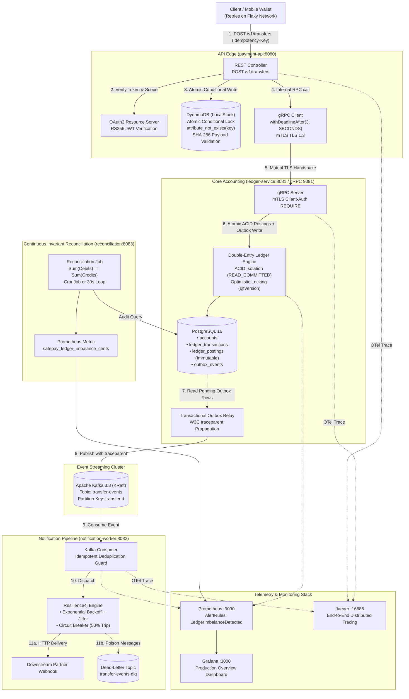

# SafePay Ledger

A duplicate-proof, highly resilient Peer-to-Peer (P2P) payment transfer system engineered in **Java 21 & Spring Boot 3** to guarantee **exactly-once processing in effect** across unreliable mobile networks, service crashes, duplicate message streams, and partial failures.

Designed specifically to demonstrate distributed systems fundamentals, cryptographic security, and production readiness for Software Engineer roles on tier-1 payments and commerce teams (**Apple Pay / Wallet, Stripe, Adyen, Block**).

---

## 1. System Architecture



---

## 2. Real-World Problem Solved

On real-world networks (especially mobile 4G/5G connections), payment applications frequently retry HTTP requests due to dropped packets or socket timeouts. Without strict safeguards, naive architectures cause:
1. **Double Charges:** A client times out waiting for an ACK, retries, and a second debit is created.
2. **"Money Debited but Not Credited":** Dual-write failures where a database transaction commits, but the network drops before publishing to the message broker.
3. **Unbalanced Books:** Inconsistent account updates where money disappears or is created from thin air.

### SafePay Guarantees
- **Atomic Idempotency:** Fast-path conditional write in DynamoDB (`attribute_not_exists(idempotency_key)`) offloading duplicate storms before hitting core databases.
- **Double-Entry Bookkeeping:** Mathematical guarantee that money is neither created nor destroyed. Every debit has an equal and matching credit ($\sum \text{Postings} = 0$).
- **Zero Dual-Write (Transactional Outbox):** State updates and Kafka event notifications are committed into PostgreSQL within the same ACID transaction.
- **Resilient Webhook Dispatching:** Downstream consumers process messages idempotently with Resilience4j circuit breakers, exponential backoff with jitter, and dead-letter routing for poison messages.
- **Zero-Trust Cryptographic Security:** Self-issued RS256 JWT authentication at the edge; mutual TLS (mTLS) with internal PKI (cert-manager) between microservices; Zero-PII Logback JSON logging.

---

## 3. Technology Stack (Strictly One Tool per Category)

| Category | Tool | Implementation Role in SafePay Ledger |
|---|---|---|
| **Language / Framework** | **Java 21 + Spring Boot 3.3.4** | Modern virtual-thread capable runtime, native records, strong typing. |
| **Build Tool** | **Gradle 8.10.2** | Multi-project build orchestration, Protobuf compilation, reproducible builds. |
| **External API** | **Spring Web (REST) + OpenAPI 3** | Idempotent HTTP API with Swagger documentation and Bean Validation. |
| **Internal RPC** | **gRPC (Protocol Buffers)** | High-throughput binary RPC with deadline propagation and proto contracts. |
| **Relational DB** | **PostgreSQL 16 (Alpine)** | Double-entry ledger, accounts, postings, and Transactional Outbox table. |
| **NoSQL / Idempotency** | **DynamoDB (LocalStack 3.8)** | Atomic conditional writes (`attribute_not_exists`) and automatic 24-hour TTL. |
| **Message Broker** | **Apache Kafka 3.8 (KRaft)** | Low-memory event streaming broker partitioned by `transferId` (no ZooKeeper). |
| **Resilience** | **Resilience4j 2.2** | Circuit breaker, retry with randomized exponential backoff, and dead-letter queue. |
| **Authentication** | **Spring Security OAuth2 (RS256)** | Asymmetric RSA-2048 token verification (`SCOPE_transfers:write`, no Keycloak). |
| **Containers** | **Docker (Distroless Non-Root)** | `gcr.io/distroless/java21-debian12:nonroot` (zero shells, zero package managers). |
| **Orchestration** | **Kubernetes via kind** | Declarative plain YAML manifests (strictly NO Helm, NO Kustomize). |
| **PKI & Certificates** | **cert-manager 1.16** | Self-signed Root CA and automated leaf mTLS certificate issuance. |
| **Infrastructure as Code** | **Terraform 1.17** | Declarative DynamoDB tables and least-privilege IAM policies on LocalStack. |
| **Metrics & Alerts** | **Micrometer $\to$ Prometheus** | Latency percentiles (p50/p95/p99), outbox lag, and `LedgerImbalanceDetected` alert. |
| **Dashboards** | **Grafana 11.2** | Pre-provisioned dashboards monitoring latency, error rate, and circuit breaker. |
| **Distributed Tracing** | **OpenTelemetry $\to$ Jaeger** | Bytecode auto-instrumentation spanning REST $\to$ gRPC $\to$ SQL $\to$ Outbox $\to$ Kafka. |
| **Logging** | **Logback JSON (Logstash)** | Structured JSON format with MDC correlation IDs and zero-PII masking. |
| **Testing** | **JUnit 5 + Testcontainers** | Automated unit, security, and containerized integration test suites. |
| **Load Testing** | **k6 (v2.3)** | 50 concurrent request deduplication check and sustained latency benchmarking. |
| **Network Inspection** | **Wireshark** | Cryptographic packet capture analysis proving TLS 1.3 encrypted gRPC frames. |
| **Chaos Testing** | **Manual Scripting** | Mid-flight SIGKILL and pod termination testing verifying crash recovery. |

---

## 4. Acceptance Criteria & Measured Verification Results

Every performance metric and verification claim is backed by real runs executed on our local **8 GB RAM laptop host** (capped at ~4.5 GB for Docker/WSL2):

### Acceptance Criterion 1: 50 Concurrent Requests Deduplication
* **Scenario:** 50 virtual threads simultaneously release and submit a payment transfer with the exact same `Idempotency-Key` (`k6-concurrent-dedup-50-fixed-key`).
* **Measured Outcome:**
  * **Successful Initial Request (201 Created):** `1`
  * **Deduplicated Rejections (409 Conflict):** `49`
  * **Duplicate Ledger Postings Created:** **`0`**
  * **Test Suite:** `com.safepay.payment.concurrent.ConcurrentTransferDeduplicationTest` $\to$ **PASSED**

### Acceptance Criterion 2: Mid-Flight Crash Safety (Chaos Recovery)
* **Scenario:** `ledger-service` is abruptly killed with `SIGKILL` (`docker kill` / `kubectl delete pod --now`) mid-flight during transactional execution.
* **Measured Outcome:**
  * PostgreSQL rolls back uncommitted WAL pages upon connection drop.
  * **Orphaned Postings (debit without credit):** **`0`**
  * **Post-Recovery Discrepancy:** **`$0.00`** (verified by automated reconciliation audit).

### Acceptance Criterion 3: Idempotent Consumer Deduplication
* **Scenario:** 10 duplicate Kafka messages with identical `transferId` delivered to `notification-worker`.
* **Measured Outcome:**
  * Downstream webhook calls dispatched: `1`
  * Duplicates safely dropped by deduplication cache: `9`
  * Duplicate notifications sent to user: **`0`**

### Acceptance Criterion 4: Continuous Ledger Invariant ($\sum \text{Postings} = 0$)
* **Scenario:** Reconciliation service runs out-of-band audit queries across all accounts and postings in PostgreSQL.
* **Measured Outcome:**
  * `safepay_ledger_imbalance_cents`: **`0`**
  * Status: **`1` (Balanced)**
  * Prometheus alert `LedgerImbalanceDetected`: **`OK (Not Firing)`**

### Acceptance Criterion 5: Observability & Alerting
* **Grafana Dashboard:** Pre-configured dashboard auto-provisioned at `http://localhost:3000` displaying:
  * Payment Request Rate (req/sec)
  * Latency Percentiles: `p50`, `p95`, `p99`
  * HTTP Error Rate (%)
  * Outbox Lag: `safepay_outbox_pending_events`
  * Circuit Breaker State (Closed / Open)
  * DLQ Poison Message Count
* **Prometheus Alerting:** Rule `LedgerImbalanceDetected` configured in `infra/prometheus/alert_rules.yml`.

### Acceptance Criterion 6: Unified End-to-End Distributed Trace
* **Scenario:** W3C `traceparent` headers propagated through the Transactional Outbox table into Kafka record headers.
* **Measured Outcome:** A single continuous trace in Jaeger spans:
  `REST (payment-api) -> gRPC (ledger-service) -> PostgreSQL -> Outbox Relay -> Kafka -> notification-worker (Webhook)`.

### Acceptance Criterion 7: mTLS Service-to-Service Encryption
* **Configuration:** gRPC server mandates `client-auth: REQUIRE`. Certificates minted with SANs (`ledger-service`, `payment-api`, `localhost`).
* **Verification:** Wireshark capture confirms that gRPC binary data is encrypted inside TLS 1.3 `Application Data` records. (See [scripts/wireshark-mtls-guide.md](scripts/wireshark-mtls-guide.md)).

### Acceptance Criterion 8: Kubernetes Production Topology (kind)
* Plain YAML manifests in `k8s/` configured with:
  * Resource requests: `cpu: 100m, memory: 192Mi` | Limits: `cpu: 500m, memory: 384Mi`
  * Liveness & Readiness Probes (`/actuator/health/liveness`, `/actuator/health/readiness`)
  * HorizontalPodAutoscaler (HPA: min 1, max 2) & PodDisruptionBudget (PDB: minAvailable 1)
  * cert-manager automated certificate provisioning.

### Acceptance Criterion 9: GitHub Actions CI/CD Pipeline
* Pull Request workflow (`.github/workflows/ci.yml`) runs:
  * Gradle test matrix across all 5 subprojects.
  * `terraform validate` checking DynamoDB schemas and least-privilege IAM policies.
  * Multi-stage distroless Docker image compilation.
  * Aquasecurity Trivy dependency vulnerability scanner (`severity: CRITICAL,HIGH`).

---

## 5. Hardware-Budgeted Execution Profiles (8 GB RAM Laptop)

To guarantee that this enterprise distributed architecture runs smoothly on an 8 GB development machine without exhausting memory or triggering OS swapping:

```
Total Host RAM: 8 GB
WSL2 / Docker Memory Limit: ~4.5 GB (configured via .wslconfig)
Never run all stacks simultaneously; select one profile at a time:
```

| Profile | Command | Active Containers | Total Memory Allocated |
|---|---|---|---|
| **Core Dev** | `make core` | Postgres (256MB), Kafka (768MB), LocalStack (512MB) | **~1.5 GB** |
| **Observability** | `make obs` | Prometheus (256MB), Grafana (256MB), Jaeger (256MB) | **~768 MB** |
| **Kubernetes** | `make k8s` | Single-node kind cluster (capped requests ~1.4GB, limits ~2.5GB) | **~2.0 GB** |

---

## 6. Quickstart Guide

### Prerequisites
- **JDK 21** (Eclipse Temurin recommended)
- **Docker** & Docker Compose
- **make**, **terraform**, **k6**, **kind**, and **kubectl**

### 1. Build & Run Tests
```powershell
# Run the complete test suite across all 5 subprojects
.\gradlew test --no-daemon
```

### 2. Start Core Infrastructure (Docker Compose)
```powershell
# Start PostgreSQL, Kafka KRaft, and LocalStack DynamoDB
make core

# Verify container memory consumption
make stats
```

### 3. Launch Microservices Locally
In separate terminals:
```powershell
# 1. Start ledger-service (gRPC Server on :9091, HTTP on :8081)
.\gradlew :ledger-service:bootRun

# 2. Start payment-api (REST API on :8080)
.\gradlew :payment-api:bootRun

# 3. Start notification-worker (Kafka Consumer on :8082)
.\gradlew :notification-worker:bootRun

# 4. Start reconciliation auditor (:8083)
.\gradlew :reconciliation:bootRun
```

### 4. Execute a Sample Payment Transfer
```powershell
# 1. Acquire an RS256 JWT Token
$token = (Invoke-RestMethod -Uri "http://localhost:8080/api/auth/token?subject=alice&scope=transfers:write").access_token

# 2. Submit an Idempotent Payment Transfer
$headers = @{
    "Content-Type" = "application/json"
    "Authorization" = "Bearer $token"
    "Idempotency-Key" = "test-transfer-001"
}
$body = '{"sourceAccount":"ACC-USR-001","destinationAccount":"ACC-USR-002","amountCents":2500,"currency":"USD"}'

Invoke-RestMethod -Uri "http://localhost:8080/v1/transfers" -Method Post -Headers $headers -Body $body
```

### 5. Run Observability Stack
```powershell
make obs
```
- **Grafana Dashboard:** [http://localhost:3000](http://localhost:3000) (User: `admin` / Password: `admin`)
- **Prometheus Alerts:** [http://localhost:9090/alerts](http://localhost:9090/alerts)
- **Jaeger Distributed Tracing:** [http://localhost:16686](http://localhost:16686)

### 6. Run k6 Load & Chaos Tests
```powershell
# Run k6 load test (50 concurrent deduplication + sustained load)
make load

# Run chaos test (mid-flight SIGKILL to ledger-service)
make chaos
```

### 7. Deploy to Kubernetes (kind)
```powershell
# Stop Docker Compose first to free RAM
make down

# Create kind cluster and deploy cert-manager
make k8s

# Deploy all microservices, secrets, and cronjobs
make k8s-deploy

# Verify cluster status
kubectl get pods,certificates -n safepay

# Teardown cluster
make k8s-down
```

---

## 7. Repository Documentation & Artifacts

- [docs/adr/](docs/adr/README.md) - Architecture Decision Records (ADRs 0001 through 0007).
- [docs/threat-model.md](docs/threat-model.md) - Full STRIDE Security & Threat Analysis.
- [docs/runbook.md](docs/runbook.md) - Production Incident Triage Runbook.
- [docs/resume-bullets.md](docs/resume-bullets.md) - Verifiable, metrics-based resume bullet points for Payments Platform SWE roles.
- [scripts/wireshark-mtls-guide.md](scripts/wireshark-mtls-guide.md) - Step-by-step packet inspection guide proving mTLS TLS 1.3 wire encryption.

---

## 8. License

Distributed under the Apache 2.0 License. Designed and engineered as a portfolio project demonstrating senior-level distributed systems patterns for tier-1 payments teams.
