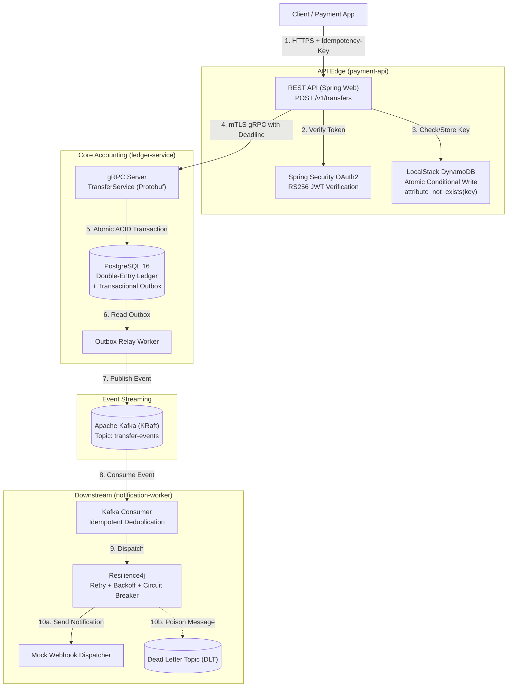

# SafePay Ledger

A duplicate-proof, highly resilient Peer-to-Peer (P2P) payment transfer system engineered to guarantee **exactly-once processing in effect** across unreliable networks, service crashes, client retries, and duplicate message streams.

Designed specifically to meet the high-reliability distributed systems and security standards of tier-1 payments teams (Apple Pay / Wallet, Commerce Platforms).

---

## Architecture Overview



---

## Real-World Problem Solved

On flaky wireless networks, mobile payment applications retry requests upon timeouts. Without distributed safeguards, naive systems suffer from:
1. **Double Charges**: Client sends request $\to$ times out $\to$ retries $\to$ second debit created.
2. **"Money Debited but Not Credited"**: Dual-write failures where database commits but message broker publish fails.
3. **Unbalanced Books**: Partial state updates or single-entry balances where debits do not match credits.

### SafePay Guarantees
- **Atomic Idempotency**: Fast-path deduplication in DynamoDB via atomic conditional writes (`attribute_not_exists(idempotency_key)`).
- **Double-Entry Bookkeeping**: Strict invariant that $\sum \text{postings} = 0$. Money is neither created nor destroyed.
- **Zero Dual-Write**: The ledger transaction and outgoing events are committed into PostgreSQL within the same ACID transaction using the **Transactional Outbox pattern**.
- **Resilient Delivery**: Downstream workers process messages idempotently with exponential backoff, jitter, and dead-letter queues.
- **End-to-End Security**: RS256 JWT at the boundary and mutual TLS (mTLS) with internal PKI (cert-manager) between microservices.

---

## Hardware Constraint & Execution Profiles (8 GB RAM Host)

To ensure this enterprise stack runs comfortably on an 8 GB development laptop without exhausting memory:
- **Strict JVM Limits**: `-Xms64m -Xmx256m -XX:+UseSerialGC -XX:MaxMetaspaceSize=128m`
- **PostgreSQL**: `shared_buffers=64MB`, `max_connections=30`
- **Kafka**: Single broker KRaft mode with `-Xmx512m` heap and short retention.
- **LocalStack**: Constrained to `SERVICES=dynamodb`.

### Run Profiles

| Profile | Command | Active Services | Intended Phase |
|---|---|---|---|
| **Core** | `make core` | Postgres, Kafka, LocalStack | Phases 1–4 |
| **Observability** | `make obs` | Prometheus, Grafana, Jaeger | Phase 5 |
| **Kubernetes** | `make k8s` | Single-node kind cluster | Phases 6–7 |

---

## Project Structure

```
Safepay_ledger/
├── common/                  # Protobuf definitions, gRPC contracts, shared models
├── ledger-service/          # gRPC double-entry engine, PostgreSQL, Outbox relay
├── payment-api/             # REST API, DynamoDB idempotency guard, gRPC client
├── notification-worker/     # Kafka idempotent consumer, Resilience4j webhook dispatcher
├── reconciliation/          # Daily/hourly invariant reconciliation auditor
├── docs/
│   ├── adr/                 # Architecture Decision Records
│   ├── threat-model.md      # STRIDE security analysis
│   ├── runbook.md           # Operational debugging procedures
│   └── resume-bullets.md    # Quantified resume bullet points
├── Makefile                 # Lifecycle management
└── docker-compose.yml       # Core infrastructure
```

---

## Quickstart (Phase 0 Baseline)

1. Verify environment tools:
   ```bash
   java -version    # OpenJDK 21
   docker --version # Docker 29+
   kind --version   # v0.33+
   k6 version       # v2.3+
   ```

2. Build all modules:
   ```bash
   ./gradlew build -x test
   ```

3. Spin up core infrastructure:
   ```bash
   make core
   make stats
   ```
