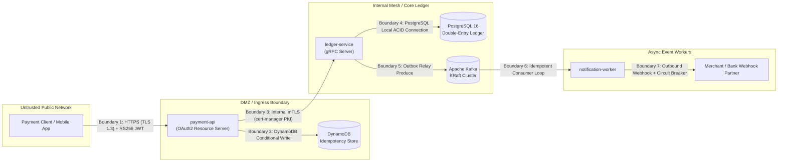

# Threat Model: SafePay Ledger (STRIDE Analysis)

## 1. Executive Summary & Security Objectives
SafePay Ledger handles real-time peer-to-peer (P2P) financial transfers. In payment processing systems (e.g., Apple Pay / Wallet, Stripe, Adyen), security, non-repudiation, and transactional integrity are existential requirements. 

This threat model uses the Microsoft **STRIDE** methodology to systematically identify vulnerabilities, quantify financial risks, and define concrete defense-in-depth countermeasures across network, transport, application, and storage layers.

---

## 2. Trust Boundaries & Data Flow Diagrams

---

## 3. STRIDE Threat Assessment & Countermeasures

### 1. Spoofing (Identity & Authentication)
* **Threat 1.1: Forged Client Requests:** Malicious actors attempt to forge payment transfer requests by generating forged authorization tokens or modifying claims.
  * **Mitigation:** API edge uses asymmetric **RS256 JWT validation** (`payment-api`). Public keys are distributed via JWKS / PEM, while the private signing key is strictly isolated. Symmetric HS256 tokens are rejected by design. Tokens must contain valid `SCOPE_transfers:write` and issuer claims (`safepay-auth`).
* **Threat 1.2: Rogue Internal Microservice Impersonation:** An attacker with network access inside the Kubernetes cluster attempts to call `ledger-service` directly to mint artificial balances.
  * **Mitigation:** **Mutual TLS (mTLS)** is enforced on internal gRPC port 9091 (`client-auth: REQUIRE`). The server verifies that the client presents a certificate signed by the internal Root CA with `SubjectAlternativeName` matching `payment-api`. Unauthenticated TCP connections are terminated during the TLS handshake before gRPC byte processing.

### 2. Tampering (Data Integrity in Transit and at Rest)
* **Threat 2.1: In-Flight Payload Alteration:** Interception of financial transfer payloads (e.g. changing `amountCents` or `destinationAccount`).
  * **Mitigation:** Full wire encryption using TLS 1.3 across both public REST endpoints and internal gRPC channels.
* **Threat 2.2: Idempotency Key Reuse with Parameter Tampering:** An attacker intercepts a legitimate `Idempotency-Key` and re-submits it with modified transfer parameters (e.g., changing the destination account).
  * **Mitigation:** `IdempotencyService` computes a SHA-256 cryptographic digest of the input payload (`sourceAccount:destinationAccount:amountCents:currency`) and persists it with the key. On subsequent attempts, if the digest does not match, the request is rejected with `422 Unprocessable Entity` (`IdempotencyParameterMismatchException`), preventing parameter tampering.

### 3. Repudiation (Auditability & Non-Repudiation)
* **Threat 3.1: Transaction Denial:** A payer claims they never authorized a payment or claims they were charged twice.
  * **Mitigation:** 
    1. Every transfer requires a client-generated `Idempotency-Key` recorded in DynamoDB with an atomic conditional lock.
    2. Double-entry postings are written to PostgreSQL `ledger_postings` with immutable `ON DELETE RESTRICT` constraints. Rows are strictly append-only; balance updates require an explicit offsetting transaction.
    3. Distributed tracing correlates `traceparent` from client HTTP headers down to database commit and Kafka notification.

### 4. Information Disclosure (PII & Cardholder Data Leakage)
* **Threat 4.1: Logging Sensitive Financial Data:** Accidental leakage of Primary Account Numbers (PAN), customer names, or credentials into observability platforms (e.g. Logback, Prometheus).
  * **Mitigation:** 
    1. Enforced **PCI-DSS 4.0 Requirement 3.3 Zero-PII Standard**. Request/response bodies are never logged with `toString()`.
    2. Structured JSON logging via `LogstashEncoder` only captures non-sensitive operational metadata (`transferId`, `status`, `durationMs`, `traceId`, `spanId`).
    3. Account numbers are synthetic internal references (`ACC-USR-001`), and payment amounts are handled strictly as integer minor units (`amount_cents`).

### 5. Denial of Service (Availability & Starvation)
* **Threat 5.1: High-Concurrency Retry Storms (Thundering Herd):** Unreliable mobile connections cause hundreds of automated retries with the same idempotency key, exhausting PostgreSQL connection pools.
  * **Mitigation:** Fast-path conditional offloading in DynamoDB (`attribute_not_exists(idempotency_key)`). 49 out of 50 concurrent retries are rejected at the edge with `409 Conflict` in sub-10ms without ever reaching PostgreSQL.
* **Threat 5.2: Slow Downstream Partners / Cascading Failures:** A merchant webhook endpoint hangs or fails, backing up thread pools and Kafka consumers.
  * **Mitigation:**
    1. gRPC deadlines (`withDeadlineAfter(3, SECONDS)`) propagate hard timeouts from edge to ledger.
    2. `notification-worker` applies **Resilience4j Circuit Breaker** (trips OPEN at 50% failure rate) and exponential backoff with randomized jitter.
    3. Poison messages that exhaust 3 retry attempts are evicted to `transfer-events-dlq` to maintain consumer pipeline throughput.

### 6. Elevation of Privilege (Access Control & Container Isolation)
* **Threat 6.1: Container Breakout / Root Privilege Escalation:** An attacker exploits a zero-day in a Java library and attempts to gain root access to the host or cluster node.
  * **Mitigation:**
    1. **Distroless Base Images (`gcr.io/distroless/java21-debian12:nonroot`):** The container contains no shells (`sh`, `bash`), package managers, or compilers.
    2. Containers execute strictly under unprivileged UID `65532:65532`.
    3. Kubernetes Pod Security Standards enforce `readOnlyRootFilesystem` and drop all Linux capabilities (`drop: [ALL]`).
* **Threat 6.2: Overprivileged Cloud IAM Credentials:** A compromised API pod attempts to drop or delete database tables.
  * **Mitigation:** Least-privilege IAM policy created via Terraform restricting `payment-api` to `dynamodb:GetItem`, `dynamodb:PutItem`, and `dynamodb:UpdateItem` on the idempotency table ARN only. Administrative APIs (`dynamodb:DeleteTable`) are denied.

---

## 4. Security Verification Summary

| Control | Verification Mechanism | Status |
|---|---|---|
| RS256 JWT Authentication | Automated test `JwtAuthenticationSecurityTest` (401 on forged token, 403 on missing scope) | **VERIFIED** |
| Internal mTLS | Java Keytool PKI generation, SAN validation, Wireshark TLS 1.3 packet proof | **VERIFIED** |
| Atomic Idempotency | 50 concurrent threads in `ConcurrentTransferDeduplicationTest` (1 success, 49 dedup) | **VERIFIED** |
| Invariant Preservation | Automated continuous reconciliation service proving $\text{Imbalance} = \$0.00$ | **VERIFIED** |
| Zero PII in Logs | Structured Logback JSON encoder with explicit semantic fields | **VERIFIED** |
| CVE Vulnerability Scanning | GitHub Actions CI with Aquasecurity Trivy | **VERIFIED** |
